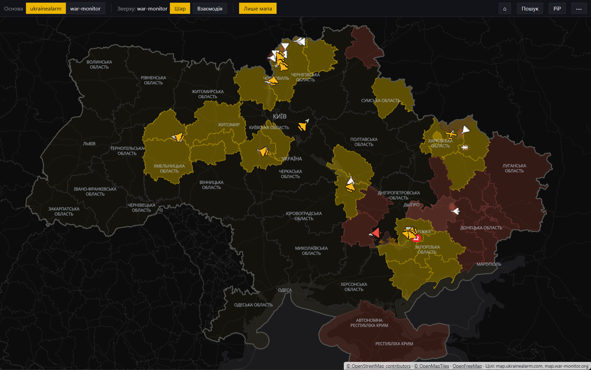

# Небогляд (Nebohliad)

[English below](#english)

Настільний застосунок для Windows, який показує дві публічні мапи повітряних
загроз України, [map.ukrainealarm.com](https://map.ukrainealarm.com/) і
[map.war-monitor.org](https://map.war-monitor.org/), в одному вікні, одну
поверх іншої, з синхронізованим масштабом і положенням.

> **Для власного використання.** Небогляд зроблено для себе й опубліковано
> як є. Його не узгоджено з розробниками map.ukrainealarm.com і
> map.war-monitor.org, і він не є продуктом чи сервісом для інших. Код
> відкритий під MIT (див. «Ліцензія»), але прохання користуватися ним так
> само: особисто, на власний ризик і з повагою до умов обох сайтів. Без
> автоматичних збірок і релізів.

> **Небогляд не є системою оповіщення.** Він лише показує дві публічні мапи
> в одному вікні.
> - Мапи показують не всі загрози: зокрема, балістичні ракети та швидкісні
>   цілі можуть не відображатися. Порожня мапа не означає безпеки.
> - Позиції цілей приблизні й надходять із затримкою; ціль може бути вже
>   ближче до вас.
> - Сповіщення Небогляду про цілі поблизу залежать від того, що показують
>   сайти, і можуть не спрацювати.
> - Покладайтеся лише на офіційні сигнали тривоги: сирени, застосунок
>   «Повітряна тривога», повідомлення органів влади. Під час тривоги одразу
>   прямуйте в укриття й залишайтеся там до відбою.
> - Застосунок надається «як є», без жодних гарантій; автор не відповідає за
>   рішення, ухвалені на його основі.



## Що вміє
- Одна мапа знизу, друга зверху: лише цілі або вся сторінка напівпрозоро;
  основну мапу можна поміняти.
- Режим «лише мапа» без інтерфейсу сайтів; пошук адрес і координат.
- Локації: основна відкриває всю свою область; сповіщення Windows, коли ціль
  у заданому радіусі від будь-якої локації.
- «Картинка в картинці» поверх усіх вікон, робота з трею, теми, українська
  та англійська.
- Трансляція на інші пристрої в локальній мережі (телефон, планшет, ТВ) у
  браузері або VLC: уся мапа чи область, обидва шари чи один, три рівні
  якості; на сторінці перегляду — відео (WebRTC або MJPEG) чи знімки, на
  весь екран, «не гасити екран», банер, коли цілі поблизу локацій,
  спливаючі й браузерні сповіщення (окремо вмикаються) про дрони й інші цілі
  поблизу локацій і про повітряну тривогу в районі локації; вхід за
  посиланням із ключем або одноразовим кодом із застосунку; сторінку
  можна додати на початковий екран телефона. Вимкнена за замовчуванням, лише
  для локальної мережі й за посиланням із ключем.

## Як це працює
- Обидва сайти відкриваються як звичайні вебсторінки, кожен у своєму вікні,
  так само як у браузері. Немає API, скрейпінгу чи запитів до внутрішніх
  адрес сайтів; перевірку Cloudflare Turnstile користувач проходить сам.
- Усе, що застосунок змінює, відбувається лише на машині користувача: він
  ховає інтерфейс сайтів і рекламні банери, після підтвердження власного
  безпекового попередження закриває схожі попередження сайтів, синхронізує
  мапи і читає позиції цілей із мапи, яку вже показує сторінка.
- Дані не стають точнішими, ніж їх показують сайти, нічого не записується і
  не ретранслюється.

## Незалежність
Небогляд — незалежний некомерційний проєкт. Він не пов’язаний зі Stfalcon,
застосунком «Повітряна тривога», map.ukrainealarm.com, war-monitor.org чи
державними органами і не схвалений ними. Назви й сайти належать їхнім
власникам. Якщо власник сайту попросить, інтеграцію з його сайтом буде
прибрано: напишіть через [Issues](https://github.com/sergak01/nebohliad/issues).

## Джерела й ліцензії
- Цілі й тривоги: [map.ukrainealarm.com](https://map.ukrainealarm.com/),
  [map.war-monitor.org](https://map.war-monitor.org/) (показуються як є).
- Картографічні дані: © [OpenStreetMap contributors](https://www.openstreetmap.org/copyright), ODbL.
- Тайли: © [OpenMapTiles](https://www.openmaptiles.org/) (CC BY 4.0),
  [OpenFreeMap](https://openfreemap.org/).
- Пошук адрес: [Nominatim](https://nominatim.org/) (© OpenStreetMap
  contributors), з дотриманням [правил використання](https://operations.osmfoundation.org/policies/nominatim/).

## Приватність
Телеметрії немає. Мережеві запити йдуть лише до двох сайтів і їхніх
сторонніх сервісів (Cloudflare, Google Analytics/Tag Manager, OpenFreeMap) та
до Nominatim (лише під час пошуку). Локації й історія пошуку зберігаються
локально в `%APPDATA%\Nebohliad`. Трансляція, коли її увімкнено, приймає
підключення лише з локальної мережі й лише за посиланням із ключем.

## Збірка
Потрібні Node.js і Windows.

```bash
npm install
npm start          # запуск
npm run dist       # інсталятор і портативна версія в dist/
```

Готових збірок немає: зберіть самі. Збірка не підписана. Якщо в Windows 11
увімкнено Smart App Control, він оцінює непідписаний файл за репутацією й
зазвичай пропускає його, а файл із самопідписаним сертифікатом блокує без
можливості запустити. Тому самопідписування (`npm run make-cert`, потім
`npm run dist:signed`) має сенс лише на ПК без Smart App Control або з
сертифікатом довіреного центру сертифікації. Жодних файлів підпису в
репозиторії немає.

## Обмеження
Застосунок залежить від внутрішньої розмітки обох сайтів (назви шарів мапи,
ключі налаштувань, кнопки). Оновлення сайту може зламати синхронізацію,
режим «лише цілі», мову, тему чи сповіщення.

## Поза межами проєкту
- Жодної інформації про ППО, мобільні вогневі групи, місця влучань чи сили
  оборони.
- Жодного уточнення даних понад те, що показують джерела: без траєкторій,
  точок ураження, архівів.
- Жодного запису чи експорту історії цілей.
- Жодної публічної ретрансляції (ботів, трансляцій в інтернет).

## Ліцензія
Код — [MIT](LICENSE). Ліцензія стосується лише коду цього репозиторію, не
вмісту сайтів і не картографічних даних.

---

## English

A Windows desktop app that shows two public Ukrainian air-threat maps,
[map.ukrainealarm.com](https://map.ukrainealarm.com/) and
[map.war-monitor.org](https://map.war-monitor.org/), in one window, one on top
of the other, with synchronized zoom and position.

> **For personal use.** Nebohliad was made for its author's own use and is
> published as is. It has not been agreed with the developers of
> map.ukrainealarm.com or map.war-monitor.org, and it is not a product or a
> service for others. The code is open under MIT (see "License"), but please
> use it the same way: personally, at your own risk, and respecting both
> sites' terms. No automated builds or releases.

> **Nebohliad is not a warning system.** It only shows two public maps in one
> window.
> - The maps do not show every threat: ballistic missiles and fast targets in
>   particular may be missing. An empty map does not mean you are safe.
> - Target positions are approximate and arrive late; a target may already be
>   closer to you.
> - Nebohliad's alerts about targets nearby depend on what the sites show and
>   may not fire.
> - Rely only on official alerts: sirens, the official air alert app,
>   announcements by the authorities. During an alert, go to a shelter right
>   away and stay there until the all-clear.
> - The app is provided "as is", without any warranty; the author is not
>   responsible for decisions made based on it.

### Features
- One map at the bottom, the other on top: targets only, or the whole page
  semi-transparent; the base map can be swapped.
- Map-only mode without the sites' interface; address and coordinate search.
- Locations: the primary one opens its whole region; Windows notifications
  when a target is within a set radius of any location.
- Always-on-top picture-in-picture, tray mode, themes, Ukrainian and English.
- Streaming to other devices on the local network (phone, tablet, TV) in a
  browser or VLC: whole map or an area, both layers or one, three quality
  levels; the viewer page offers video (WebRTC or MJPEG) or snapshots,
  fullscreen, keep-screen-on, a banner when targets are near a location, and
  pop-up and browser notifications (each can be turned off) about drones and
  other targets near a location and air alerts in a location's area; sign in
  with the link and its key or a one-time code from the app; it can
  be added to a phone's home screen. Off by default, local network
  only, and only with a link that carries a key.

### How it works
- Both sites open as normal web pages, each in its own window, just as in a
  browser. No API, no scraping, no requests to the sites' internal endpoints;
  the user passes the Cloudflare Turnstile check themselves.
- Everything the app changes happens only on the user's machine: it hides the
  sites' interface and promo banners, closes the sites' similar safety notices
  once its own notice is confirmed, synchronizes the maps, and reads target
  positions from the map the page already shows.
- Data never gets more precise than the sites show it; nothing is recorded or
  rebroadcast.

### Independence
Nebohliad is an independent, non-commercial project. It is not affiliated with
or endorsed by Stfalcon, the "Povitriana Tryvoha" (Air Alert) app,
map.ukrainealarm.com, war-monitor.org or any government body. Names and sites
belong to their owners. If a site owner asks, the integration with their site
will be removed: please open an [issue](https://github.com/sergak01/nebohliad/issues).

### Sources and licenses
- Targets and alerts: map.ukrainealarm.com, map.war-monitor.org (shown as
  they are).
- Map data: © [OpenStreetMap contributors](https://www.openstreetmap.org/copyright), ODbL.
- Tiles: © [OpenMapTiles](https://www.openmaptiles.org/) (CC BY 4.0),
  [OpenFreeMap](https://openfreemap.org/).
- Address search: [Nominatim](https://nominatim.org/) (© OpenStreetMap
  contributors), following its [usage policy](https://operations.osmfoundation.org/policies/nominatim/).

### Privacy
No telemetry. Network requests go only to the two sites and their third-party
services (Cloudflare, Google Analytics/Tag Manager, OpenFreeMap) and to
Nominatim (only when searching). Locations and search history stay local in
`%APPDATA%\Nebohliad`. The stream, when turned on, accepts connections only
from the local network and only with a link that carries a key.

### Build
Requires Node.js and Windows.

```bash
npm install
npm start          # run
npm run dist       # installer and portable build in dist/
```

There are no prebuilt releases: build it yourself. The build is unsigned. If
Smart App Control is on in Windows 11, it judges an unsigned file by
reputation and usually lets it run, but it blocks a file with a self-signed
certificate with no way to run it. So self-signing (`npm run make-cert`, then
`npm run dist:signed`) only makes sense on PCs without Smart App Control, or
with a certificate from a trusted certificate authority. No signing files are
in the repository.

### Limitations
The app depends on both sites' internal markup (map layer names, storage keys,
buttons). A site update can break synchronization, targets-only mode,
language, theme or alerts.

### Out of scope
- No information about air defense, mobile fire groups, impact sites or
  defense forces.
- No refining data beyond what the sources show: no trajectories, impact
  points or archives.
- No recording or exporting of target history.
- No public rebroadcasting (bots, internet streams).

### License
Code: [MIT](LICENSE). The license covers only the code in this repository,
not the sites' content or the map data.
